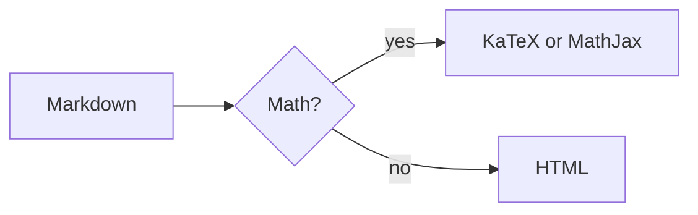

<!-- section: headings -->

# Heading level 1
## Heading level 2
### Heading level 3
#### Heading level 4
##### Heading level 5
###### Heading level 6
####### Seven hashes is a paragraph
#NoSpace is a paragraph on GitHub

Setext heading level 1
======================

Setext heading level 2
----------------------

## Closing hashes are stripped ##
### Heading with *italic* and `code` inside

<!-- section: paragraphs -->

This paragraph is written
across three source lines
that GitHub joins into one flowing paragraph.

Hard break with two trailing spaces  
next line after two spaces.

Hard break with a backslash\
next line after backslash.

Single newline inside a paragraph is a soft break, so this line
and this line render on the same visual line on GitHub.

<!-- section: emphasis -->

*italic star* and _italic underscore_

**bold star** and __bold underscore__

***bold italic star*** and ___bold italic underscore___

**bold with *nested italic* inside** and *italic with **nested bold** inside*

snake_case_name and __init__ and file_name_here.py stay literal

**bold**text works but __bold__text does not

un*frigging*believable works but un_frigging_believable does not

~~strikethrough two tildes~~ and ~strikethrough one tilde~

**unclosed bold and *unclosed italic

a * b * c with spaced stars stays literal

<!-- section: inlinecode -->

Use `printf()` here.

Backtick inside: `` a ` b `` and double: ``` a `` b ```

Spaces are stripped: `` `foo` `` shows backticks

Markers inside code are literal: `**not bold**` and `a_b_c` and `[x](y)`

Code spanning
lines `foo
bar` joins with a space

<!-- section: links -->

Inline link: [GitHub](https://github.com)

Inline link with title: [GitHub home](https://github.com "GitHub home")

Reference full [ref link][gh], collapsed [gh][], shortcut [gh], case-folded [Ref][GH]

Autolink: <https://example.com/path?q=1> and email <user@example.com>

Bare URLs: https://www.example.com/page and www.example.com and user@example.org

Formatting in link text: [**bold link** and `code`](https://example.com)

Relative link [the README](README.md) and anchor [to h1](#heading-level-1)

Issue #1, mention @sheng-tse, commit 8c23c85

[gh]: https://github.com "GitHub"

<!-- section: images -->

Relative: 

Remote: 

Data URI: 

Linked image: [](https://github.com)

Text before  text after

<!-- section: bullets -->

- Level one dash
  * Level two star
    + Level three plus
    + Another level three
  * Back to level two
- Level one again
* Changing marker starts a new list

<!-- section: ordered -->

3. Ordered starting at three
4. Four
5. Five

1. All ones
1. Still renders as 2
1. Renders as 3

8) Paren delimiter starts at eight
9) Nine

- Bullet with ordered inside
  1. First nested ordered
  2. Second nested ordered
     - Bullet inside ordered inside bullet

A paragraph line
2. two does not interrupt a paragraph

<!-- section: tasks -->

- [ ] Unchecked task
- [x] Checked task with **bold**
  - [ ] Nested unchecked
  - [X] Nested checked uppercase X
    - [ ] Third level task
1. [ ] Ordered task item
2. [x] Ordered checked task

<!-- section: loose -->

Tight list:
- tight a
- tight b

Loose list:
- loose a

- loose b

- Item with a second paragraph

  Second paragraph inside the item, indented.

  ```python
  print("code in list")
  ```

<!-- section: quotes -->

> Blockquote level one
> continues here
lazy continuation line without marker
>
> > Nested blockquote level two
> > - list inside nested quote
> > - second item
> >
> > ```bash
> > echo "code in quote"
> > ```
>
> Back to level one with **bold**.

<!-- section: alerts -->

> [!NOTE]
> Useful information that users should know, even when skimming.

> [!TIP]
> Helpful advice for doing things better or more easily.

> [!IMPORTANT]
> Key information users need to know to achieve their goal.

> [!WARNING]
> Urgent info that needs immediate user attention to avoid problems.

> [!CAUTION]
> Advises about risks or negative outcomes of certain actions.

> [!note]
> Lowercase type name.
>
> Second paragraph in the alert.

<!-- section: code -->

```python
def fib(n: int) -> int:
    """Return the n-th Fibonacci number."""
    return n if n < 2 else fib(n - 1) + fib(n - 2)
```

```bash
for f in *.ipynb; do echo "$f"; done
```

```json
{"name": "jupynvim", "version": "0.4.6", "tags": ["nvim", "jupyter"]}
```

```rust
fn main() { println!("hello {}", 42); }
```

```
plain fence without a language
```

~~~python
tilde_fence = True
~~~

````markdown
```python
nested_fence = True
```
````

    indented code block line 1
    indented code block line 2

```python
very_long_code_line = "this code line is deliberately longer than the window so we can see whether it wraps or scrolls horizontally like GitHub"
```

<!-- section: math-basic -->

```math
\frac{a}{b} = \sum_{i=1}^{n} x_i^2
```

Inline $x^2 + y_1$ and backtick form $`\sqrt{x^2+1}`$ in prose.

$$
\begin{pmatrix} a & b \\ c & d \end{pmatrix}
$$

$$\int_0^\infty e^{-x^2}\,dx = \frac{\sqrt{\pi}}{2}$$

$$
\frac{1}{n}\sum_{i=1}^{n}\left(x_i - \bar{x}\right)^2
$$

Prices like $5 and $10 are not math.

<!-- section: tables -->

| Left | Center | Right |
|:-----|:------:|------:|
| a | b | c |
| **bold** | `code` | *it* |
| escaped \| pipe | [link](https://x.com) | 1,234.56 |
| ragged |

Name | Value
--- | ---
no outer pipes | 1

<!-- section: widetable -->

| id | first_name | last_name | email_address | department | job_title | start_date | salary_usd | manager | office_location |
|---|---|---|---|---|---|---|---|---|---|
| 1 | Alexandra | Montgomery | alexandra.montgomery@example.com | Engineering | Senior Software Engineer | 2019-03-14 | 185000 | Jordan Lee | San Francisco, CA |
| 2 | Bartholomew | Fitzgerald | bart.fitzgerald@example.com | Marketing | Director of Brand | 2021-11-02 | 162500 | Priya Patel | New York, NY |

<!-- section: hr -->

Above the rules

---

***

___

- - -

Below the rules

<!-- section: footnotes -->

Here is a footnote reference[^1] and a named one[^note].

[^1]: The first footnote.
[^note]: A named footnote with **bold**.

<!-- section: html -->

<details>
<summary>Click to expand</summary>

Hidden content with **markdown** inside.

</details>

Line one<br>line two after br.

Press <kbd>Ctrl</kbd>+<kbd>C</kbd> to copy.

H<sub>2</sub>O and E = mc<sup>2</sup>


<!-- This comment is hidden on GitHub -->

<p align="center">Centered paragraph</p>

<ins>inserted</ins> <mark>marked</mark> <b>b tag</b> <i>i tag</i> <s>s tag</s> <code>code tag</code>

<span style="color:red">styled span</span> <script>alert(1)</script>

<!-- section: emoji -->

:rocket: :+1: :tada: :smile: :heavy_check_mark: :not_an_emoji:

\*not italic\* \# not heading \[not link\](x) \`not code\` \\ backslash

&copy; &nbsp;x &amp; &lt;tag&gt; &#169; &#x1F600; &ne;

<!-- section: mixed -->

## Heading followed immediately by a list
- item right after heading
- second item
### Heading followed immediately by code
```python
x = 1
```
Paragraph directly above a quote
> quote directly below a paragraph

<!-- section: wrapping -->

This is a very long single source line that keeps going well past the right edge of a normal terminal window so that we can observe how the renderer wraps prose, whether it breaks at word boundaries, and whether the continuation rows keep any indentation or decoration that the first row had, which matters for lists and quotes.

- A very long list item that also runs past the right edge of the window so we can see whether the wrapped continuation rows hang under the text of the item or fall back to the left margin like plain text does.

> A very long blockquote line that runs past the right edge of the window so we can see whether the quote bar is repeated on each wrapped continuation row or only drawn on the first visual row.

## A very long heading that runs past the right edge of the window to see whether the heading style and prefix glyph carry onto the wrapped continuation row

<!-- section: math-inline -->

Inline $x^2$, then $x$, $y$; and ($z$) or [$w$] or "$v$" at the end $u$.

Word-adjacent: the $x$-axis, the $n$th term, foo$x$bar, 2$x$3, plural $\alpha$s.

Spaces inside the delimiters: $ x $ and $x $ and $ x$.

Currency: it costs $5 and $10 per item, $1,000 total or $20.50 each.

Currency then math on one line: to split $100 in half, we calculate $100/2$.

Same with a span: to split <span>$</span>100 in half, we calculate $100/2$.

Escaped dollars stay text: \$5 and \$10 each.

An escaped dollar inside math: $\$4 + x$ and $`\sqrt{\$4}`$.

Both on one line: \$5 and \$10, then $\$4 + x$.

Backtick form: $`a_1 * b_2 * c_3`$ and $`x < y`$ and $`\{1,2\}`$.

Code spans stay code: `$HOME` and `$x$` and `a $ b $ c`.

Empty and doubled: $$ alone and $ $ single space.

Inline math across a soft line break: $a +
b = c$ continues here.

Adjacent maths: $a$$b$ and $a$ $b$.

<!-- section: math-nested -->

# Heading with $E = mc^2$ math

## Heading with $`\alpha`$ backtick math

*Italic with $a_1$ inside* and **bold with $\sum_i x_i$ inside** and ~~struck $x$~~.

_underscore emphasis with $x_1$ and $y_1$ inside_

[Link text with $x^2$](https://example.com) and footnote with math[^m].

- List item with $x^2$
- Item with display math:

  $$
  \int_0^1 x\,dx
  $$

  1. Nested ordered with $\alpha$
     - Deeper with $\beta_{ij}$

| Expression | Note |
|---|---|
| $x^2$ | $4$ |
| $\frac{a}{b}$ | `code` |
| $\lvert x \rvert$ | abs via lvert |
| $|x|$ | pipe inside math |
| $$x$$ | display in a cell |

> Quote with $e^{i\pi} + 1 = 0$
>
> $$
> \sum_{n=1}^\infty \frac{1}{n^2} = \frac{\pi^2}{6}
> $$

> [!NOTE]
> Alert with inline $x \in \mathbb{R}$ and display:
>
> $$a^2 + b^2 = c^2$$

[^m]: Footnote containing $\sqrt{2}$.

<!-- section: math-display -->

Display on one line:

$$E = mc^2$$

Display spanning lines:

$$
f(x) = \int_{-\infty}^{\infty} \hat{f}(\xi)\, e^{2 \pi i \xi x} \, d\xi
$$

Text before $$x = \frac{-b \pm \sqrt{b^2-4ac}}{2a}$$ text after in the same paragraph.

A paragraph line
$$
y = mx + b
$$
directly continues without blank lines.

$$
a = b

c = d
$$

```math
\begin{aligned}
\nabla \cdot \mathbf{E} &= \frac{\rho}{\varepsilon_0} \\
\nabla \times \mathbf{B} &= \mu_0 \mathbf{J}
\end{aligned}
```

```math
x = 1 \\ y = 2
```

~~~math
\sqrt{2}
~~~

<!-- section: math-env -->

$$
\begin{align}
a &= b + c \\
d &= e + f
\end{align}
$$

$$
\begin{align*}
x &= 1 \\
y &= 2
\end{align*}
$$

$$
\left\{
\begin{aligned}
u_t &= \Delta u \\
u(0) &= u_0
\end{aligned}
\right.
$$

$$
\begin{gathered}
a = b \\
c = d + e
\end{gathered}
$$

$$
|x| = \begin{cases} x & \text{if } x \ge 0 \\ -x & \text{otherwise} \end{cases}
$$

$$
\begin{matrix} a & b \\ c & d \end{matrix}
\quad
\begin{pmatrix} 1 & 0 \\ 0 & 1 \end{pmatrix}
\quad
\begin{bmatrix} 1 & 2 \\ 3 & 4 \end{bmatrix}
\quad
\begin{vmatrix} a & b \\ c & d \end{vmatrix}
$$

$$
\left[\begin{array}{c|cc} 1 & 2 & 3 \\ \hline 4 & 5 & 6 \end{array}\right]
$$

$$
\begin{equation}
e^{i\pi} + 1 = 0 \tag{Euler} \label{eq:euler}
\end{equation}
$$

See equation $\eqref{eq:euler}$ and $\ref{eq:euler}$.

<!-- section: math-bare -->

Bare environment after a blank line:

\begin{align}
\dot{x} &= \sigma (y - x) \\
\dot{y} &= \rho x - y - xz
\end{align}

Bare environment right after a text line:
\begin{equation}
a^2 + b^2 = c^2
\end{equation}

Parenthesis delimiters: \(x^2 + y^2\) inline, and bracket display:

\[
\int_0^1 x^2\,dx = \frac{1}{3}
\]

Doubled-backslash delimiters (classic notebook form): \\(a + b\\) and

\\[
c + d
\\]

<!-- section: math-macros -->

$$
\newcommand{\RR}{\mathbb{R}}
\def\norm#1{\left\lVert #1 \right\rVert}
\newcommand{\abs}[1]{\left| #1 \right|}
$$

Using the macros in the same block: $x \in \RR$, $\norm{v}$, $\abs{-3} = 3$.

Defining a name that already exists: $\newcommand{\R}{\mathbf{R}} \R$, then $\renewcommand{\R}{\mathbf{R}} \R$.

Operator names: $\operatorname{argmax}_{x} f(x)$, $\operatorname{Tr}(A)$, built-ins $\max_i a_i$ and $\sin x$.

Fonts: $\mathbb{R} \mathbb{N}$, $\mathcal{L} \mathcal{O}$, $\mathfrak{g} \mathfrak{A}$, $\mathrm{d}x$, $\mathbf{v}$, $\boldsymbol{\alpha}$, $\text{with spaces inside text}$, $x \text{ if } y$.

<!-- section: math-constructs -->

Macros from the previous section reused here: $\RR^n$ and $\norm{x}_2$.

$$
\frac{1}{1 + \frac{1}{1 + \frac{1}{x}}} \quad \dfrac{a}{b} \quad \tfrac{a}{b} \quad \sqrt[3]{x} \quad \sqrt[n]{1 + x^2}
$$

$$
\left( \sum_{k=1}^{n} \frac{x_k}{\sqrt{1 + x_k^2}} \right)^{2} \left[ \int_0^1 \frac{dt}{1+t} \right]
$$

$$
\overbrace{a + b + c}^{\text{three terms}} = \underbrace{x + y}_{\text{two terms}}
$$

$$
\boxed{E = mc^2} \quad \color{red}{x + y} \quad {\color{blue} z} \quad \textcolor{green}{w}
$$

$$
\underset{x \to 0}{\lim} f(x) \quad \overset{?}{=} \quad A \xrightarrow{f} B \xleftarrow[g]{h} C \quad \binom{n}{k} \quad \tbinom{n}{k}
$$

$$
\lim_{n \to \infty} \left(1 + \frac{1}{n}\right)^n \quad \sum_{i=1}^{n} i \quad \prod_{p \text{ prime}} \frac{1}{1-p^{-s}} \quad \int_{a}^{b} f \quad \iint_D \quad \oint_C
$$

$$
\begin{CD}
A @>f>> B \\
@VgVV @VVhV \\
C @>>k> D
\end{CD}
$$

<!-- section: math-conflicts -->

Plain text a_1 * b_2 * c_3 is markdown, math $a_1 * b_2 * c_3$ must keep the stars.

Two maths with underscores: $x_1$ and $y_1$ and $z_{1}$.

Stars: $a*b*c$ and $a * b$ next to *real italic*.

Escapes inside math: $\{a, b\}$, $a \, b$, $a\;b$, $\|v\|$, $a \\ b$, $\#\%\&\_$, $\$$.

Comparison and ampersand: $a<b$, $a < b$, $a>b$, $x \lt y$, $a \& b$, $p \land q$.

Percent comment inside display math:

$$
a + b % this is a comment
= c
$$

A display math line that starts with a plus sign:

$$
a % comment
+ c
$$

Unicode inside math: $α + β = γ$, $x ≤ y$, $\text{café naïve}$, $∀x∈ℝ$.

Invalid formula one: $\frac{1}{$ here.

Invalid formula two: $\badmacro{x}$ here.

Invalid formula three: $x^$ here.

$$
\begin{align}
a &= b
\end{aligned}
$$

HTML-like text inside math: $x<y>z$ and $a <b> c$ (kept last on purpose).

<!-- section: mermaid -->


